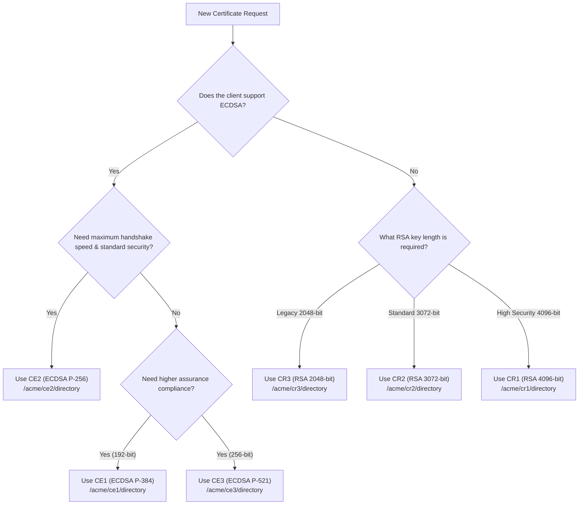

import { Callout } from 'fumadocs-ui/components/callout';

CertSmith implements a two-tier Public Key Infrastructure (PKI) designed to deliver modern cryptographic performance while preserving seamless compatibility with legacy enterprise systems.

---

## Complete Tier Matrix

CertSmith operates **6 distinct intermediate authority tiers** under a single unified Root CA anchor:

### Elliptic Curve Cryptography (ECC) Tiers

| Tier Name | Key Algorithm | Curve Spec | Security Equivalent | ACME Directory Endpoint | Recommended Use |
| :--- | :--- | :--- | :--- | :--- | :--- |
| **CE2** *(Default)* | ECDSA | P-256 (`prime256v1`) | 128-bit symmetric | `/acme/ce2/directory` | Modern web applications, microservices, gRPC, and container ingress. |
| **CE1** | ECDSA | P-384 (`secp384r1`) | 192-bit symmetric | `/acme/ce1/directory` | High-assurance enterprise, compliance, and government workloads. |
| **CE3** | ECDSA | P-521 (`secp521r1`) | 256-bit symmetric | `/acme/ce3/directory` | Maximum cryptographic resistance and long-term security. |

### RSA Cryptography Tiers

| Tier Name | Key Algorithm | Key Size | Security Equivalent | ACME Directory Endpoint | Recommended Use |
| :--- | :--- | :--- | :--- | :--- | :--- |
| **CR3** *(Legacy)* | RSA | 2048-bit | 112-bit symmetric | `/acme/cr3/directory` | Maximum interoperability with legacy IoT, older embedded devices, and older Java 7/8 runtimes. |
| **CR2** | RSA | 3072-bit | 128-bit symmetric | `/acme/cr2/directory` | Enterprise standard RSA matching current NIST/ANSSI minimum recommendations. |
| **CR1** | RSA | 4096-bit | 140-bit symmetric | `/acme/cr1/directory` | Archival, high-security RSA signing where elliptic curves cannot be used. |

---

## Root Certificate Authority (Root CA)

The **CertSmith Root CA** is the foundational trust anchor generated on the initial startup of the appliance:

- **Key Type**: RSA 4096-bit or ECDSA P-384 (depending on appliance initialization profile).
- **Default Validity**: 10 Years (3,650 days).
- **Subject Name**: `CN = CertSmith Root CA, O = CertSmith Private Trust Network`.
- **Key Usage**: `Digital Signature`, `Certificate Signing`, `CRL Signing` (`critical`).
- **Basic Constraints**: `CA:TRUE` (`critical`).

```
Certificate:
    Data:
        Version: 3 (0x2)
        Serial Number: 4a:2b:8c:1d:9e:3f:7a:5b
        Signature Algorithm: sha256WithRSAEncryption
        Issuer: CN = CertSmith Root CA, O = CertSmith
        Validity
            Not Before: Jan  1 00:00:00 2026 GMT
            Not After : Dec 31 23:59:59 2035 GMT
        Subject: CN = CertSmith Root CA, O = CertSmith
        X509v3 extensions:
            X509v3 Basic Constraints: critical
                CA:TRUE
            X509v3 Key Usage: critical
                Certificate Sign, CRL Sign
```

---

## Intermediate Authorities (Issuing CAs)

Each intermediate tier possesses an isolated private key signed by the Root CA:

- **Intermediate Validity**: 3 Years (1,095 days).
- **Path Length Constraint**: `pathlen:0` (prevents intermediate CAs from minting further subordinate CAs).
- **Automated Chain Delivery**: When an ACME client asks for a certificate, CertSmith automatically bundles the intermediate certificate in the response payload (`fullchain.pem`), ensuring connecting browsers only need the Root CA installed.

---

## How to Choose the Right Tier

When requesting a certificate for a service, select the tier based on the following decision criteria:



<Callout type="tip">
  **Recommendation**: Always default to **CE2** (`/acme/ce2/directory`) unless legacy device constraints force you to use **CR3**.
</Callout>
